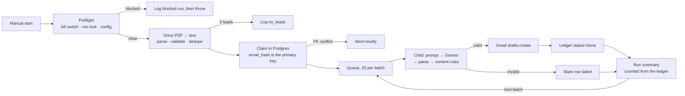

# ⚙️ Outreach drafter — a lead PDF becomes personalised Gmail drafts, held for a human to send

**🛠️ Engineers: full technical breakdown → [TECHNICAL.md](./TECHNICAL.md)**

## 🎯 The problem, and who has it

A solo consultant in Nigeria works a single list of about 2,000 B2B leads, exported from a spreadsheet to a PDF and shared as a Google Drive link. Each lead needs a first-touch email that names the person's role and employer and reads like a person wrote it. Every one of those emails has to land as a Gmail draft, not a sent message, so a human still decides what leaves the building.

The work is not hard, it is just relentless: 2,000 near-identical emails, each of which has to be a little bit different, and none of which may be sent by a machine. Done by hand it is a week of copy-paste with no record of who was written to and no way to resume after the laptop closes.

The person who has this problem is also the person who approves the output and pays for it. There is no second reviewer, which is why the design refuses to send anything and puts all state in a database instead of in someone's memory.

## ⚡ What it does now

A manual trigger starts a run. The parent workflow reads its config from Postgres, refuses to start if the kill switch is on or another run is live, downloads the PDF from Drive, extracts the text, parses and de-duplicates the rows, claims each surviving lead in Postgres, and queues them 25 at a time. Each batch is handed to a child workflow that builds a prompt from the lead's own fields, calls Gemini, parses the JSON reply, re-validates the draft against content rules, creates a Gmail draft, and writes the outcome back to the ledger. When the queue drains, the parent counts results from the ledger and closes the run.

Three workflows do the work: a parent (24 nodes, manual trigger), a child (14 nodes, executed once per batch), and an ops sink (3 nodes, error trigger).

The recorded volume is the input size and the configured ceiling, not a measured time saving: about 2,000 lead rows, 25 drafts per run and 25 per batch by default, and 81 n8n executions for a full 2,000-lead sweep (one parent plus eighty children). A three-lead test batch produces two drafts and rejects the third at Gmail. No before-and-after timing for this work exists in the build records, so none is claimed here.

## 🛡️ How it stays compliant

| Surface | Direction | Volume per run | Auth |
| --- | --- | --- | --- |
| Google Drive `files.get` | read | 1 | OAuth2, `drive.readonly` |
| Google Gemini `generateContent` | inference | one call per lead, paced | API key from a Postgres table |
| Gmail `users.drafts.create` | write, drafts only | one per lead | OAuth2, `gmail.compose` |
| Supabase Data API | read and write | ~4 reads, one insert and one update per lead | secret key |

- **Nothing is sent, structurally.** The `gmail.compose` scope also permits sending, so the control cannot be the scope. It is the graph: zero `message:send`, zero `threads.reply`, zero label nodes. Audit it by searching node types, not by trusting a setting.
- **No inbound surface.** The only trigger is manual. There is no webhook and no respond-to-webhook node, so there is no unauthenticated endpoint to find.
- **The durable record holds no personal data.** The ledger keys on a SHA-256 hash of the lowercased email plus its domain. It never stores a name, an address, a title or a company. Those live in execution memory and in the Gmail draft itself.
- **Execution data is off.** Successful executions are not saved on all three workflows; only failures are, which is what makes the error sink useful without hoarding lead payloads.
- **Errors are redacted before they are stored.** The failure table takes a run id, a node name, an error code and a message capped at 200 characters with email-shaped substrings replaced.
- **Row-level security is on with no policies.** The four documented tables enable RLS and define no policies, so the secret key bypasses it and an anonymous key gets nothing.
- **Retention is the honest gap.** Ledger rows and failure rows are kept indefinitely; there is no deletion job. What is retained is a hash rather than a person, but the drafts themselves live in Gmail under the operator's own account, and nothing prunes them.

## ✅ How I know it works

- **Validation, re-run on the published JSON:** parent 0 errors / 3 warnings, child 0 errors / 1 warning, ops 0 errors / 0 warnings. All four warnings are the same deliberate setting — `executeOnce` on the chained `getAll` reads that would otherwise fire once per input row.
- **The test payload is designed to fail once.** Three pinned leads at the child trigger produce two drafts; the third carries a malformed address, so Gmail rejects it deterministically and the failed branch writes `status=failed`. It proves both the success path and the failure path without depending on the model misbehaving.
- **A live 25-lead batch completed end to end on 2026-10-25**, spread across fourteen rotated API keys, which also confirmed the parent had been re-pointed at the rebuilt child and that every credential had been re-attached after import.
- **Failure modes with a defined exit:** missing config fails closed; a scanned PDF hits the parse gate and halts before a single draft exists; zero valid leads is logged as a successful `no_leads` run; a duplicate claim is converted into a loud abort; a Gemini 429 is retried four times and paced rather than dropped.
- **Incidents closed during the build:** a per-run cap that retries silently bypassed, a quota counter that recorded thirteen real calls as one, a sign-off the prompt asked for but was never given, and a `Wait` node that would have released a whole batch at once instead of pacing it.
- **Two defects are open and documented below**, which is the part that matters: the build is not described as finished where it is not.

## 🚧 Limitations / what I'd do next

- **Title and employer cannot be separated from the extracted PDF text.** The extraction collapses table columns to single spaces, so there is no delimiter left to split on, and every draft receives the two fields merged into one honest string. Fixing it means changing the input contract — a CSV or XLSX read, which is a plan-level change, not a patch. A heuristic split was tested and rejected: it fails silently, and a silenced failure here is permanent because a drafted lead is skipped forever.
- **Ledger updates are paired by list position, not by identity.** It is dormant while every item survives to the write, and it fires the moment one draft is rejected or one Gmail call fails. The fix is to carry the identity on the item and key the writes off it; it changes a node's output contract, so it needs its own round of tests.
- **A 25-draft batch needs at least two fresh API keys**, because each key is capped at 19 requests per day. A half-spent day yields zero drafts rather than a smaller batch.
- **OAuth in "Testing" status expires its refresh token in seven days**, so a batch must finish inside that window or the OAuth app must be published.
- **One run at a time.** The run lock is read-then-write, so two runs started in the same second can both pass. After any hard abort the run row is stranded as `running` and blocks new runs for four hours until it is cleared by hand.
- **The API-key table sits outside the documented schema.** It was added when the model transport changed, and its row-level-security state is not recorded anywhere, which is the first thing I would check on a real deployment.
- **No retention job**, as noted above.

## 👋 About me & get in touch

I'm Faith Leke-Akingboye, an AI Automation Engineer and GTM Engineer. I build AI-powered
systems that cut manual spend across departments — because the expensive work rarely sits
inside one team, it sits in the handoffs between sales, operations and finance. Every build
ships documented, so whoever inherits it can run and extend it.

**Orchestration** n8n · Make · Zapier   **Agents** LangChain · LangGraph · CrewAI   **Voice** Vapi · Retell · ElevenLabs   **Retrieval** Pinecone · Qdrant · Supabase pgvector

Open to full-time, contract and consulting engagements. Full overlap with Europe and Africa,
about four hours with US Eastern, async everywhere else.

[GitHub](https://github.com/Faith-Leke) · [LinkedIn](https://www.linkedin.com/in/faith-leke-akingboye/) · faithlekeakingboye@gmail.com
