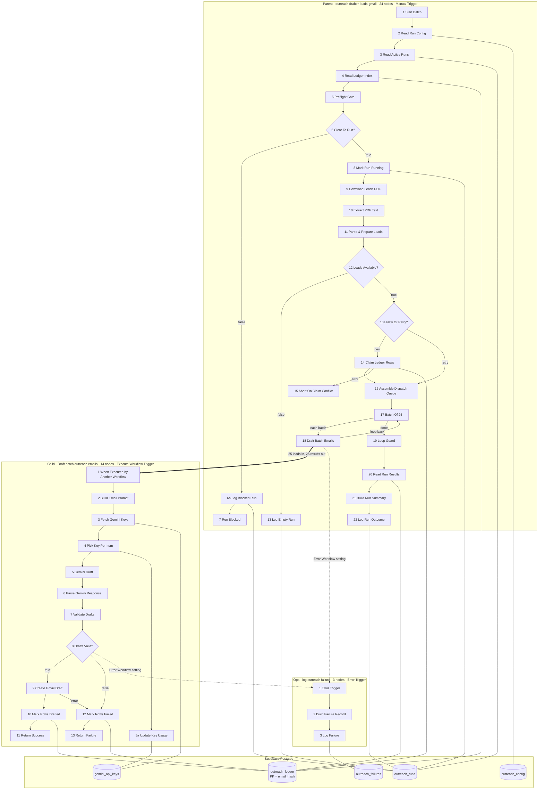

# 📘 Outreach drafter — technical reference

## 📌 Status

| | |
| --- | --- |
| **Systems** | Three workflows: parent + child + ops sink (parent/child architecture) |
| **Logic nodes** | 41 total — parent 24, child 14, ops 3 |
| **Canvas notes** | 11 sticky notes (not executable) |
| **Trigger** | Parent: Manual Trigger, the only entry point. Child: Execute Workflow Trigger. Ops: Error Trigger |
| **Last verified** | 2026-10-29 — `validate_workflow`, profile `runtime` |
| **n8n** | latest stable at deploy; no numeric version is recorded in the build artifacts |
| **Workflow hashes** | parent `dbb7fe29`, child `b940ea6e`, ops `6854cf14` (SHA-256, first 8) |
| **Timezone** | `Africa/Lagos` on all three |
| **Successful execution data** | not saved on all three; failures are saved |

Validation re-run for this publication — this run's numbers, not a receipt's:

| Workflow | Errors | Warnings | Warning source |
| --- | ---: | ---: | --- |
| parent | 0 | 3 | `executeOnce` on `3 Read Active Runs`, `4 Read Ledger Index`, `20 Read Run Results` |
| child | 0 | 1 | `executeOnce` on `3 Fetch Gemini Keys` |
| ops | 0 | 0 | — |

Every warning is the same deliberate guard: a `getAll` node downstream of another `getAll` executes once per input row unless `executeOnce` is set. None is a defect.

## 🎯 What it does & who it's for

Reads a lead list from a PDF in Google Drive, drafts one personalised email per lead with Gemini, and saves each as a Gmail draft rather than sending it. It is built for one operator working a one-off batch of roughly 2,000 B2B leads, who is also the approver and the budget owner. Every stage is resumable from Postgres, so a run can be stopped and re-entered without duplicating a lead.

## 🗂️ Repo layout

| File | What it is |
| --- | --- |
| `README.md` | The case study. Start here. |
| `TECHNICAL.md` | This document. |
| `parent.json` | **Import this first of the JSONs.** Batch state: config, kill switch, run lock, parse, dedupe, claim, dispatch, reporting. |
| `child.json` | One batch of leads → Gemini → validated Gmail drafts. Per-lead state. |
| `ops.json` | Error Trigger sink. Writes a sanitised failure row. |
| `build-workflows.mjs` | Builder for **parent and ops only**. See the warning below. |
| `src/*.js` | Code-node bodies, one per node, embedded verbatim into the JSON. |

**Import order:** `child.json`, then `ops.json`, then `parent.json`. The parent's `18 Draft Batch Emails` needs the child to exist before you can point at it.

**The builder does not reproduce the child.** `build-workflows.mjs` still emits the superseded `chainLlm` design for the child; re-running it would overwrite the working `child.json` with an obsolete one. It also has no source for `6 Parse Gemini Response`, so the child's node bodies exist only inside `child.json`. Treat the three JSON files as the artifacts of record, and the builder as a parent/ops generator.

## 🏗️ Architecture overview

Three workflows, one direction of trust: the parent owns every piece of batch state, the child owns every piece of per-lead state, and the ops sink owns nothing except a failure row. Neither cross-workflow arrow below is a wire in n8n — n8n has no cross-workflow edges. They are the `Execute Workflow` call and its returned items, and the Error Workflow setting.



****

| Stage | Workflow | Nodes | What it settles |
| --- | --- | --- | --- |
| S1 Preflight & locks | Parent | 1–7 | Kill switch, overlapping-run lock, config parse. Fails closed. |
| S2 Ingest & parse | Parent | 8–13 | Drive download, PDF text, row parse, validation, dedupe. Parse gate halts before any draft. |
| S3 Claim & queue | Parent | 13a–16 | Postgres primary key claims each new lead; retries route around the claim; one dispatch queue. |
| S4 Batch loop | Parent | 17–18 | One batch of ≤25 in flight, child awaited, loop back until drained. |
| S5 Report | Parent | 19–22 | Counts read back from the ledger, not from memory, and written to the run row. |
| C1 Generate | Child | 1–6 | Typed inputs, prompt build, key pick, Gemini call, JSON parse. |
| C2 Validate & draft | Child | 7–13 | Content rules, Gmail draft creation, ledger write, item returned to parent. |
| O1 Capture | Ops | 1–3 | Sanitised failure row for anything that escapes per-node handling. |

****

`inputSource: workflowInputs` (Define Below), so the trigger exposes a typed schema and never silently reads whatever the caller forwarded. One item per lead, 25 items per execution.

| Field | Type | Required | Meaning |
| --- | --- | --- | --- |
| `run_id` | string | yes | `run_YYYYMMDD_HHmm`; stamped on every ledger write |
| `lead_id` | string | yes | PDF serial number, traceability only, never sent to an API |
| `name` | string | yes | ≤ 80 chars, control characters stripped |
| `email` | string | yes | validated, ≤ 254 chars |
| `title` | string | no | ≤ 120 chars, may be empty |
| `company` | string | no | ≤ 120 chars, may be empty |
| `email_hash` | string | yes | 64-char lowercase hex; the ledger key |
| `attempt` | number | yes | 0 on first claim; retries carry the stored value |
| `enrichment_note` | string | no | inert in v1, always empty |

****

| Field | Type | Notes |
| --- | --- | --- |
| `ok` | boolean | true only when Gmail returned a draft id |
| `status` | string | `done` or `failed` |
| `email_hash` | string | join key back to the ledger |
| `draft_id` | string or null | Gmail draft id |
| `error` | string or null | `code: message`, truncated to 200 chars, addresses redacted |

Expected failures come back as data (`ok: false`) rather than as thrown errors. Only infrastructure breakage throws.

**Batch mode.** `18 Draft Batch Emails` runs `mode: once` with `waitForSubWorkflow: true`: one child execution per 25 leads, every node inside it iterating per item. `mode: each` would run the child 25 times and turn a 2,000-lead sweep into 2,001 executions instead of 81.

## 🧱 Phases & technical features

Type strings below are the `n8n-nodes-base.` suffix; the JSON uses the full `n8n-nodes-base.<name>` form. Node order matches the JSON, not the alphabet.

****

| # | Node | Type | typeVersion | Error policy |
| --- | --- | --- | --- | --- |
| 1 | 1 Start Batch | manualTrigger | 1 | — |
| 2 | 2 Read Run Config | supabase | 1 | alwaysOutputData |
| 3 | 3 Read Active Runs | supabase | 1 | executeOnce, alwaysOutputData |
| 4 | 4 Read Ledger Index | supabase | 1 | executeOnce, alwaysOutputData |
| 5 | 5 Preflight Gate | code | 2 | stopWorkflow |
| 6 | 6 Clear To Run? | if | 2.4 | — |
| 7 | 6a Log Blocked Run | supabase | 1 | stopWorkflow, alwaysOutputData |
| 8 | 7 Run Blocked | stopAndError | 1 | — |
| 9 | 8 Mark Run Running | supabase | 1 | stopWorkflow, alwaysOutputData |
| 10 | 9 Download Leads PDF | googleDrive | 3 | stopWorkflow, retry ×3 |
| 11 | 10 Extract PDF Text | extractFromFile | 1.2 | stopWorkflow |
| 12 | 11 Parse & Prepare Leads | code | 2 | stopWorkflow |
| 13 | 12 Leads Available? | if | 2.4 | — |
| 14 | 13 Log Empty Run | supabase | 1 | alwaysOutputData |
| 15 | 13a New Or Retry? | if | 2.4 | — |
| 16 | 14 Claim Ledger Rows | supabase | 1 | continueErrorOutput, alwaysOutputData |
| 17 | 15 Abort On Claim Conflict | code | 2 | stopWorkflow |
| 18 | 16 Assemble Dispatch Queue | code | 2 | stopWorkflow |
| 19 | 17 Batch Of 25 | splitInBatches | 3 | — |
| 20 | 18 Draft Batch Emails | executeWorkflow | 1.4 | stopWorkflow, retry ×2, alwaysOutputData |
| 21 | 19 Loop Guard | limit | 1 | alwaysOutputData |
| 22 | 20 Read Run Results | supabase | 1 | executeOnce, alwaysOutputData |
| 23 | 21 Build Run Summary | code | 2 | stopWorkflow |
| 24 | 22 Log Run Outcome | supabase | 1 | stopWorkflow, alwaysOutputData |

****

| # | Node | Type | typeVersion | Error policy |
| --- | --- | --- | --- | --- |
| 1 | 1 When Executed by Another Workflow | executeWorkflowTrigger | 1.3 | — |
| 2 | 2 Build Email Prompt | code | 2 | stopWorkflow |
| 3 | 3 Fetch Gemini Keys | supabase | 1 | executeOnce, alwaysOutputData |
| 4 | 4 Pick Key Per Item | code | 2 | stopWorkflow |
| 5 | 5 Gemini Draft | httpRequest | 4.3 | continueRegularOutput, retry ×4 |
| 6 | 5a Update Key Usage | supabase | 1 | — |
| 7 | 6 Parse Gemini Response | code | 2 | — |
| 8 | 7 Validate Drafts | code | 2 | stopWorkflow |
| 9 | 8 Drafts Valid? | if | 2.4 | — |
| 10 | 9 Create Gmail Draft | gmail | 2.2 | continueErrorOutput, retry ×3 |
| 11 | 10 Mark Rows Drafted | supabase | 1 | stopWorkflow, alwaysOutputData |
| 12 | 11 Return Success | set | 3.5 | — |
| 13 | 12 Mark Rows Failed | supabase | 1 | stopWorkflow, alwaysOutputData |
| 14 | 13 Return Failure | set | 3.5 | — |

****

| # | Node | Type | typeVersion | Error policy |
| --- | --- | --- | --- | --- |
| 1 | 1 Error Trigger | errorTrigger | 1 | — |
| 2 | 2 Build Failure Record | code | 2 | — |
| 3 | 3 Log Failure | supabase | 1 | stopWorkflow, alwaysOutputData |

****

Eleven sticky notes hold phase headers and the manual-credential warnings: `Sticky Note 1`, `Sticky Note 2`, `Sticky Note 3`, `Sticky Note 4`, `Sticky Note 5`, `Sticky Note 6` on the parent; `Sticky Note 7`, `Sticky Note 8`, `Sticky Note 9` on the child; `Sticky Note 10`, `Sticky Note 11` on the ops sink. They are documentation on the canvas, not executable, and they carry the highest-consequence instructions (re-point the child, attach credentials, assign the Error Workflow).

****

- **Postgres primary key as the idempotency arbiter.** The claim is an insert; the database, not application logic, refuses a second row for an already-seen address.
- **Retry branch that bypasses the claim.** A retry already owns its ledger row, so re-inserting it would hit the primary key. `13a New Or Retry?` routes retries straight to the dispatch queue.
- **Key rotation with a hard capacity gate.** Fourteen keys in a table, each capped at 19 requests per day, spent in a running ordinal so the counter records real calls.
- **Pacing instead of pausing.** `5 Gemini Draft` uses the HTTP Request node's own batching at one request per 7 s, not a `Wait` node.
- **Failure-as-data.** The child returns `ok: false` for expected failures; only infrastructure breakage throws, so the parent never has to attribute an anonymous error item to a lead.

## 🧰 Tech stack

| Layer | What |
| --- | --- |
| Orchestration | n8n Cloud Pro (recorded plan: 10,000 executions per month) |
| State | Supabase Postgres, five tables |
| Model | Google Gemini, `gemini-3-flash-preview`, called over HTTP with a rotated API key |
| Mail | Gmail API, `users.drafts.create`, scope `gmail.compose` |
| Source | Google Drive `files.get`, scope `drive.readonly`, text-layer PDF |
| Parsing | n8n `extractFromFile` (`pdf`, `joinPages: true`) and a Code-node row parser |
| Build | Node ESM builder for parent and ops; Code bodies kept as individual `.js` files |

## 🔌 External dependencies

Each figure below is inlined because the research notes that produced it stay private.

- **Gmail draft quota:** `drafts.create` costs 10 quota units against 6,000 units/min/user — 600 drafts/min of headroom against this workflow's sequential ~200/min — [Gmail API quota](https://developers.google.com/workspace/gmail/api/reference/quota), retrieved 2026-10-24.
- **Drive quota:** a download costs 200 units; 325,000 units/min/user, 1,000,000 units/min/project, 400,000,000 units/day billing threshold. New quotas apply to projects created on or after 2026-05-01 — [Drive API limits](https://developers.google.com/workspace/drive/api/guides/limits), retrieved 2026-10-24.
- **Gemini rate model:** limits are enforced per project, not per key, with RPM, TPM and RPD all applied and spend caps checked over a rolling 10 minutes; exceeding any of them returns `429 RESOURCE_EXHAUSTED`. Per-model RPM is no longer published, so this design assumes no rate at all and paces requests instead — [Gemini API rate limits](https://ai.google.dev/gemini-api/docs/rate-limits), retrieved 2026-10-24.
- **OAuth refresh-token expiry:** a Google Cloud project whose consent screen is external and still in "Testing" issues a refresh token that expires in 7 days. A token also dies on user revocation, 6 months unused, a password change where Gmail scopes are present, or more than 100 live tokens per account per client — [Google OAuth 2.0](https://developers.google.com/identity/protocols/oauth2), retrieved 2026-10-24.
- **Supabase Data API:** only Auth endpoints publish rate limits; there is no published per-minute limit for the PostgREST Data API, and this workflow's few thousand single-row operations per run are negligible against it — [Supabase rate limits](https://supabase.com/docs/guides/platform/rate-limits), retrieved 2026-10-24.
- **n8n executions:** Cloud Pro at 10,000 executions per month, from the recorded plan. This design spends `1 + ceil(N/25)`, i.e. 81 executions for 2,000 leads.

## 🚀 Setup & import runbook

1. **Create the database.** Run the DDL below, then enable row-level security on each table and create no policies. The secret key bypasses RLS; an anonymous key gets nothing.
2. **Seed config.** Insert the five `outreach_config` rows: `kill_switch=false`, `max_drafts_per_run=25`, `max_parse_failure_pct=2`, `batch_size=25`, `leads_pdf_url=<share link>`. Preflight fails closed if any is missing or unparseable.
3. **Import `child.json`.** Attach `supabaseApi` to `3 Fetch Gemini Keys`, `5a Update Key Usage`, `10 Mark Rows Drafted`, `12 Mark Rows Failed`, and `gmailOAuth2` (`gmail.compose`) to `9 Create Gmail Draft`. Gemini needs no n8n credential — keys come from the table.
4. **Import `ops.json`.** Attach `supabaseApi` to `3 Log Failure`.
5. **Import `parent.json`.** Attach `supabaseApi` to `2`, `3`, `4`, `6a`, `8`, `14`, `20`, `22` and `googleDriveOAuth2Api` (`drive.readonly`) to `9 Download Leads PDF`.
6. **Re-point the child.** `18 Draft Batch Emails` imports with an empty `workflowId` because the child's id only exists after import. Pick `Draft batch outreach emails` in the dropdown. Its `cachedResultName` already reads that, which is a label, not a link — verify the id, do not trust the name.
7. **Assign the Error Workflow.** Set `Ops: log outreach failure` as the Error Workflow on **both** parent and child. This is a UI-only setting with no API or MCP equivalent, and it is what makes every `stopWorkflow` loud instead of silent.
8. **Fill the sender block.** Replace the sender placeholders at the top of `2 Build Email Prompt` before the first live run — not after. Placeholder-salted drafts pass the content gate, get written as `done`, and are then skipped forever.
9. **Use `gemini_api_keys`.** Rows of `id`, `api_key`, `daily_usage`, `key_name`. A 25-draft batch needs `Σ(19 − daily_usage) ≥ 25`, so at least two fresh keys.
10. **Verify the settings.** Timezone `Africa/Lagos` and "save successful execution data = none" are already in each workflow's `settings`; confirm rather than re-set.
11. **Activation.** None required. The parent is started by hand, the child is called by the parent, and the ops sink is fired by the Error Workflow assignment.

There is no credential block in `parent.json` or `ops.json`; `child.json` carries two `supabaseApi` references (an id and a display name, no secret) left over from the instance it was exported from. Re-attaching them to your own credential replaces the reference.

****

```sql
create table outreach_config (key text primary key, value text not null);

create table outreach_ledger (
  email_hash   text primary key,          -- SHA-256(lower(trim(email)))
  email_domain text,
  status       text not null default 'pending'
               check (status in ('pending','done','failed')),
  run_id       text,
  draft_id     text,
  attempt      int  not null default 0,
  note         text,
  updated_at   timestamptz not null default now()
);

create table outreach_runs (
  run_id         text primary key,
  started_at     timestamptz not null default now(),
  finished_at    timestamptz,
  status         text not null
                 check (status in ('running','completed','blocked','no_leads','failed')),
  total_parsed   int, valid int, duplicates int, parse_failures int,
  drafted        int, failed int, deferred int,
  blocked_reason text
);

create table outreach_failures (
  id bigserial primary key, run_id text, workflow text, node text,
  error_code text, error_message text, occurred_at timestamptz default now()
);

alter table outreach_config   enable row level security;
alter table outreach_ledger   enable row level security;
alter table outreach_runs     enable row level security;
alter table outreach_failures enable row level security;
-- Deliberately no policies: the secret key bypasses RLS, an anonymous key gets nothing.
```

The fifth table, `gemini_api_keys` (`id`, `api_key`, `daily_usage`, `key_name`), was added when the model transport changed. It is not part of the DDL above, and its row-level-security state is not recorded in the build artifacts — set it explicitly on a real deployment, because that table holds API keys.

## ⚙️ Configuration reference

| Setting | Where | Default | Effect |
| --- | --- | --- | --- |
| `kill_switch` | `outreach_config` | — (fails closed) | Anything other than a parseable `false` halts the next run at preflight |
| `max_drafts_per_run` | `outreach_config` | 25 | Hard ceiling on emitted leads per run, retries included |
| `max_parse_failure_pct` | `outreach_config` | 2 | Parse failures above this percentage throw before any draft exists |
| `batch_size` | `outreach_config` | 25 | Items per child execution, read by `17 Batch Of 25` |
| `leads_pdf_url` | `outreach_config` | — | Drive share link; preflight derives the file id and fails closed if unparseable |
| `daily_usage` | `gemini_api_keys` | 0 | Per-key counter; each key is capped at 19 requests per day |
| `batchInterval` | `5 Gemini Draft` options | 7000 ms | One request every 7 s; not a per-batch pause |
| `maxTries` | `5 Gemini Draft` | 4 | Retries a 429 or timeout before the item continues with an error |
| `maxTries` | `9 Create Gmail Draft` | 3 | Retries transient Gmail failures inside the node |
| `maxTries` | `9 Download Leads PDF`, `18 Draft Batch Emails` | 3 / 2 | Drive download and child call |
| `timezone` | workflow `settings` | `Africa/Lagos` | Timestamp consistency across all three |
| `saveDataSuccessExecution` | workflow `settings` | `none` | Successful executions are not persisted |

## 🧪 Test payload & expected result

The child can be tested on its own by pinning the trigger. Two leads are valid; the third is deliberately malformed so the failure path fires without depending on the model.

```json
{
  "1 When Executed by Another Workflow": [
    {
      "json": {
        "run_id": "run_20261024_1530",
        "lead_id": "1",
        "name": "Ada Lovelace",
        "email": "ada@example.com",
        "title": "Head of Operations",
        "company": "Analytical Engines Ltd",
        "email_hash": "b5fc85e55755f9e0d030a10ab4429b6b2944855f9a0d60077fe832becbc41d72",
        "attempt": 0,
        "enrichment_note": ""
      }
    },
    {
      "json": {
        "run_id": "run_20261024_1530",
        "lead_id": "2",
        "name": "Grace Hopper",
        "email": "grace@example.com",
        "title": "VP Engineering",
        "company": "Compilers Inc",
        "email_hash": "b533d4547eaa5a0fa955965a1ca393ccd2ea013032a105726f232eb41bddc4fa",
        "attempt": 0,
        "enrichment_note": ""
      }
    },
    {
      "json": {
        "run_id": "run_20261024_1530",
        "lead_id": "3",
        "name": "Failure Probe",
        "email": "not-an-email",
        "title": "QA",
        "company": "Testco",
        "email_hash": "eba038945cb806ba629b6f4524d54ac7dddd3c3f46bcb12b19d9cf727aa4bdf5",
        "attempt": 0,
        "enrichment_note": ""
      }
    }
  ]
}
```

The `email_hash` values are the real `sha256(lowercase(email))` for those three addresses.

| Path | Expected |
| --- | --- |
| `1` trigger | 3 items, one per lead |
| `2 Build Email Prompt` | 3 items, each with `prompt` and `prompt_json` |
| `3 Fetch Gemini Keys` | key rows, once (`executeOnce`) |
| `4 Pick Key Per Item` | 3 items, each carrying `api_key` and its own `new_usage_count`; throws if the remaining budget across all keys is below 3 |
| `5 Gemini Draft` | one request every 7 s; `{candidates: [...]}` per item |
| `6 Parse Gemini Response` | 3 items, each `{output: {subject, body}}` — item count preserved even on a malformed reply |
| `7 Validate Drafts` | 3 items with `valid`, `subject`, `body`; the malformed address may fail validation here or at Gmail |
| `8 Drafts Valid?` | valid items to `9`, rejected items to `12` |
| `9 Create Gmail Draft` | 2 draft ids; `not-an-email` rejected by Gmail and surfaced on the error output |
| `10` / `12` | ledger rows updated to `done` / `failed`; without pre-inserted rows these match 0 rows, which is harmless |
| `11` / `13` | 2 × `{ok: true}`, 1 × `{ok: false}` |

Pre-insert the three `email_hash` rows into `outreach_ledger` as `pending` with `run_id = run_20261024_1530` if you want the ledger writes to match a row.

The parent is tested with a single empty item from the Manual Trigger. The ops sink is tested by sending a synthetic `execution`/`workflow` event whose error message contains `Parse gate failed: 40/2000 rows unparsed (2.0%). No drafts created.`

## 🚨 Error strategy & failure modes

Two rules govern every branch. A `main[1]` edge that points at nothing silently drops the failed item and never reaches the Error Workflow — so anything intended for the ops sink uses `stopWorkflow` plus the Error Workflow assignment, which is the only working wiring. Anything whose error sink stays inside the same workflow is a real `main[1]` edge.

| Node | Strategy | Why |
| --- | --- | --- |
| `5 Preflight Gate` | stopWorkflow | A blocked run must be loud; `6a` logs before `7` throws |
| `6a Log Blocked Run` | stopWorkflow | If the block cannot be recorded, the run must not proceed |
| `8 Mark Run Running` | stopWorkflow | Without the run row the lock is meaningless |
| `9 Download Leads PDF` | stopWorkflow + retry ×3 | No PDF, nothing to do |
| `10 Extract PDF Text` | stopWorkflow | A scanned PDF yields empty text; the parse gate would otherwise see 0/0 |
| `11 Parse & Prepare Leads` | stopWorkflow | The parse gate throws above 2% failures |
| `14 Claim Ledger Rows` | continueErrorOutput → `15` | A primary-key conflict is the duplicate guard firing |
| `15 Abort On Claim Conflict` | stopWorkflow | Names the conflict count and halts |
| `18 Draft Batch Emails` | stopWorkflow + retry ×2 | A crash must not continue with unattributable items |
| `2 Build Email Prompt` | stopWorkflow | Prompt construction failure is structural |
| `4 Pick Key Per Item` | stopWorkflow | Insufficient key budget must fail before spending anything |
| `5 Gemini Draft` | continueRegularOutput + retry ×4 | A 429 becomes an error on the item, so cardinality survives; dropping items instead would shift the index pairing downstream |
| `7 Validate Drafts` | stopWorkflow | Its output is the reference list every later write pairs against |
| `9 Create Gmail Draft` | continueErrorOutput → `12` + retry ×3 | A rejected address is a per-lead failure, not a run failure |
| `10` / `12` | stopWorkflow | A ledger write that fails silently is worse than a halted run |

****

This build's registry is G1–G5 (global) and E1–E10 (technical edge cases); there is no separate F-series.

| # | Risk | Defence |
| --- | --- | --- |
| G1 | Duplicate draft for the same person | `email_hash` is the primary key; the database refuses the second insert. A lead is drafted only if the insert succeeded. Retries are explicit and bounded. |
| G2 | Quiet hours | Waived on purpose, with a structural compensating control: nothing is transmitted, every artefact is an inert draft, and the graph contains zero send, reply or label nodes. If sending is ever added, the waiver is void. |
| G3 | PII exposure | Ledger stores a hash and a domain only; run log stores counts; failure table stores ids and codes, redacted and capped at 200 characters; successful execution data is off on all three workflows. |
| G4 | Need to stop the machine without editing it | `kill_switch` read at preflight, fail-closed on a missing row, missing table or unparseable value. One cell stops the next run. |
| G5 | 2,000 drafts appearing at once | Three brakes: a 25-draft cap, truncation with the shortfall recorded as `deferred`, and one batch in flight at a time. The final brake is a human pressing send. |
| E1 | Two overlapping runs | An advisory lock reads `outreach_runs` for a `running` row inside four hours and aborts. The lock is read-then-write with no unique constraint, so two runs started in the same second can both pass; damage is bounded to one duplicate per colliding lead and is visible. Recovery: set the stranded run to `failed` and re-run. |
| E2 | Empty everything | Six zero-states each have an exit: no config fails closed; no ledger rows seeds an empty set; an empty PDF trips the parse gate; zero valid leads is a successful `no_leads` run; `getAll` returning nothing yields `{}` and every access is guarded; the batch node never receives zero items. |
| E3 | Prompt injection from PDF text | Three layers: control characters stripped and field lengths capped; untrusted values wrapped in a `<lead_field>` tag declared as data, never instructions; outgoing drafts rejected if they carry a URL, a foreign address, a price, a phone number or a commitment word. |
| E4 | PDF table drift or a scanned PDF | Each row must satisfy a strict shape; failures are counted, never dropped, and persisted on both the normal and the `no_leads` path. Above 2% the run halts before a draft exists. |
| E5 | Model output shape drift | A structured prompt asking for JSON only, `responseMimeType: application/json`, a parse node that tolerates fences and malformed replies while preserving item count, then hand-written content rules. |
| E6 | Draft created but the ledger write failed | Strict ordering — claim, generate, draft, mark done. A crash between the draft and the mark leaves the row `pending`; a later run retries it. The trade is deliberate: a duplicate draft is deletable, a missing draft is invisible. |
| E7 | 429 or spend-cap storm | Retries with waits inside the HTTP and Gmail nodes, plus one request per 7 s. An exhausted retry leaves the row retryable rather than failed. |
| E8 | `getAll` fan-out | Every `getAll` downstream of another is `executeOnce`, and the gate that consumes them runs once for all items. Without this the preflight would execute once per ledger row. |
| E9 | Child crash destroying lead attribution | The child returns failures as data; the execute-workflow node keeps `stopWorkflow` so a real crash halts visibly instead of continuing with unattributable items; attribution is recovered from the ledger by the stale-`pending` rule. |
| E10 | Batch/length mismatch in the index join | The validator asserts that the item count equals the lead count and throws rather than pairing every subsequent draft onto the wrong recipient. |

## 📡 Observability

| Signal | Lands in | Read by | Cadence |
| --- | --- | --- | --- |
| Run outcome and counters | `outreach_runs` (`running` → `completed` / `blocked` / `no_leads`) | the operator | after each manual run |
| Per-lead status | `outreach_ledger` (`pending` / `done` / `failed`, `attempt`, `note`, `draft_id`) | the operator | when a batch looks short |
| Escaped failures | `outreach_failures` via the Error Workflow | the operator | when a run ends badly |
| Per-key spend | `gemini_api_keys.daily_usage` | the operator | before starting a batch |
| Execution history | n8n, failures only | the operator | on investigation |

There is no chat surface, no alerting integration and no dashboard: everything is a Postgres row read by the one person who runs the workflow. That is a deliberate consequence of having no webhook — there is no request to answer, so there is nowhere to answer it. The gap is that nobody is told a run failed; the operator has to look.

## 🔁 Idempotency & data handling

- **Dedupe key:** `sha256(lower(trim(email)))`, stored as `email_hash`, the primary key of `outreach_ledger`. The same address can never be claimed twice, in one run or across runs.
- **Claim before draft.** Insert first, draft second. A lead is drafted only if the insert succeeded, so a crash loses at most the work on the batch, never a record of it.
- **Retry rules:** a lead is retryable when its row is `failed`, or `pending` and older than 120 minutes, and `attempt < 2`. Retries route around the claim because they already own a row.
- **`attempt` is a retry counter, not a status.** Only the two marking nodes increment it, both downstream of validation.
- **Personal data:** never persisted outside the Gmail draft. The ledger keeps a hash and a domain; the run log keeps counts; the failure table keeps ids, node names, error codes and a redacted message.
- **Retention:** none implemented. Ledger and failure rows persist indefinitely; nothing prunes drafts. A retention job is the obvious next addition, and the `updated_at` column is already there to drive it.

## 💰 Cost model

The figures below are the recorded planning estimates from the build's manifest, kept as estimates and not as a bill.

| Unit | Recorded estimate | Basis |
| --- | --- | --- |
| n8n Cloud Pro | $50/month, 10,000 executions | recorded plan |
| n8n per draft | ~$0.005 | plan price divided per execution, at the time each draft was assumed to consume one |
| Gemini per draft | ~$0.0003 | recorded estimate for the paid tier |
| All-in per draft | ~$0.0053 | sum of the two |
| 2,000-lead sweep | ~$10.60 | 2,000 × all-in |

Two corrections that follow from what was actually built:

- **Executions drive the n8n line, not drafts.** The built design spends `1 + ceil(N/25)` executions — 81 for 2,000 leads — so at the recorded plan price the n8n share of a full sweep is roughly $0.41, about 0.8% of the monthly allowance. The $10.60 headline assumed one execution per draft.
- **The model line is currently zero and the constraint is keys.** The transport moved to API keys held in Postgres on the free tier, each capped at 19 requests per day, so a 25-draft batch needs `Σ(19 − daily_usage) ≥ 25`. On the current design the binding constraint is key count, not spend.

## ⚖️ Design decisions & tradeoffs

- **Parent/child, because 41 logic nodes is not one workflow.** Two workflows plus a sink; no single one exceeds 30 nodes. The child also isolates a model or parser failure from the parent's control flow and makes the drafting contract independently testable.
- **`mode: once`, not `each`.** One child execution per 25 leads costs 81 executions for 2,000 leads; one execution per lead costs 2,001. `waitForSubWorkflow` is kept so the parent cannot advance the loop before a batch resolves.
- **The database is the idempotency arbiter.** Application logic that checks "have I seen this?" before inserting has a race; a primary key does not.
- **Truncate the batch, do not throw.** A 25-draft pilot is impossible on a 2,000-row PDF if exceeding the cap is fatal. Truncation is self-healing because untouched leads were never claimed, and the shortfall is recorded as `deferred`.
- **Claim, then draft — never the reverse.** A duplicate draft is deletable; a lead marked done with no draft is invisible and permanent.
- **LangChain nodes were replaced with an HTTP Request against `generativelanguage.googleapis.com`.** The LangChain model node hit a payment wall, and a self-hosted key table gave control over spend and rotation. The trade: `autoFix` and a structured output parser were lost, so a hand-written parse node now has to tolerate fences and malformed replies, and the child gained a Supabase read and a side-branch update.
- **Pacing in the HTTP node, not a `Wait` node.** A `Wait` pauses the workflow execution, not each item, so 25 items would have been released together after one pause. `batchSize: 1` with `batchInterval: 7000` sends one request every 7 s.
- **`stopWorkflow` plus the Error Workflow, not a dotted edge to the ops sink.** n8n has no cross-workflow edge; a `main[1]` pointing at nothing drops the item silently.
- **`continueRegularOutput` on the model call.** Letting errored items leave on an error branch would renumber the items reaching the validator, and the downstream writes pair by index. Keeping the count intact and turning the failure into data preserves the pairing.
- **One honest merged field for role and employer.** The PDF text cannot be split deterministically, so the prompt is given the whole string and told it may quote one contiguous span. A heuristic split was tested against real rows and rejected: it fails silently, and a silenced failure here is permanent because a drafted lead is skipped forever.

## 🔧 Troubleshooting

Only failures that were observed and diagnosed during the build appear here.

**Drafts name a company called "your organisation", and every title contains the employer**
Cause: the PDF extraction collapses table columns to single spaces, so the title/employer splitter finds no delimiter and puts the entire remainder in one field while the other stays empty. Extraction offers no layout-preserving option, so no node setting can fix it. This is a design flaw in the input contract, not an implementation slip. Fix: the prompt now receives one merged field and is told the role and employer are run together; it may quote one contiguous span and must invent nothing. A permanent fix is a plan-level change to a delimited input such as CSV.

**Switching the source to CSV "needs no other node changes"**
Cause: it does. `extractFromFile` with `csv` returns one item per row keyed by header, while the parser reads a single `text` field — it would receive nothing, parse zero rows, and throw on a 0/0 gate. Fix: rewrite the parse contract as part of the change.

**A run created twice the configured number of drafts**
Cause: the per-run cap was applied to new leads only; retries were appended afterwards uncapped. With a 25 cap, 25 retries plus 25 new emitted 50 items, which split into two batches. Fix: build the emitted list as retries first, then new leads, then slice to the budget — retries first so older work is not starved by fresh work, and truncated retries stay eligible for the next run.

**The per-key quota guard never tripped, though the key count showed 1 after 13 calls**
Cause: the usage counter was read once per batch from a cached snapshot and incremented per item, so every item on a key wrote the same value and last-write-wins recorded a single call. Fix: each item writes `base + taken` — its own running ordinal on that key — and, because a partial batch is impossible downstream, the picker sums the remaining budget across all keys and throws before the first call if it cannot cover the batch.

**A batch released all 25 model requests at once**
Cause: a `Wait` node pauses the workflow execution, not each item, so every item resumed together after one pause. Fix: the HTTP Request node's own batching, one request per 7 s, plus retries for a 429.

**Placeholder-salted drafts were marked done and never retried**
Cause: the content gate's placeholder pattern matched `{{ }}` and square brackets but not angle brackets, so `<SENDER FULL NAME>` passed validation, the row was written as `done`, and the parser skips `done` rows forever. Fix: the sender block is filled before the first live run, and any placeholder guard must also cover `<[A-Z][A-Z _+]*>`. This failure is silent and irreversible in a way that the loud failures in the same gate are not.

**The prompt asked for a sign-off that was never supplied**
Cause: the sender signature was declared and referenced zero times, while a rule instructed the model to end with it — directly contradicting the rule to invent nothing. Fix: the signature is injected as a verbatim sign-off block and the rule points at it.

**A re-imported child did not take effect**
Cause: importing mints a new workflow id, so the parent kept calling the old one, and no credentials travel with an import. Fix: re-pick the child in `18 Draft Batch Emails` and re-attach every credential. A completed end-to-end run afterwards is the only proof the re-point happened; the `cachedResultName` label is not.

## 🚧 Known limitations & roadmap

1. **The parse contract cannot separate role from employer.** Open, and escalated to planning rather than patched around. Every draft currently receives them merged.
2. **Ledger writes pair by list position.** Dormant while nothing is filtered out; fires on the first invalid draft or Gmail failure, and can cross a draft id onto another lead's hash. The fix is to carry `email_hash`, `run_id` and `attempt` on the validator's output and key every write off them — but the Gmail error branch replaces the item's JSON with `{ error }`, so identity there has to come from `pairedItem` or the branch has to be restructured. Needs its own test matrix.
3. **The run lock is advisory.** Two runs in the same second can both pass preflight. Operating rule: one at a time.
4. **A hard abort strands the run row** as `running` and blocks new runs for four hours until it is cleared by hand.
5. **Seven-day OAuth refresh token** while the consent screen is in "Testing".
6. **Key budget, not money, caps a batch.** 19 requests per key per day means a second 25-draft batch on the same day needs more keys or a reset.
7. **`gemini_api_keys` sits outside the documented schema**, and its RLS state is unrecorded.
8. **No retention or deletion job**, and no alerting: a failed run waits for a human to look.
9. **The builder no longer matches the child.** `build-workflows.mjs` still emits the LangChain design and would overwrite `child.json`; `6 Parse Gemini Response` has no source file in `src/`.

## 🏷️ Version history

| Version | Date | Change |
| --- | --- | --- |
| v1 | 2026-10-29 | First publication. Validation re-run: parent 0 errors / 3 warnings, child 0 / 1, ops 0 / 0. |

## 👋 Get in touch

Faith Leke-Akingboye — AI Automation Engineer / GTM Engineer. Questions about this build, or one
like it, are welcome — open an issue for a bug, a PR for an improvement.

**Orchestration** n8n · Make · Zapier   **Agents** LangChain · LangGraph · CrewAI   **Voice** Vapi · Retell · ElevenLabs   **Retrieval** Pinecone · Qdrant · Supabase pgvector

[GitHub](https://github.com/Faith-Leke) · [LinkedIn](https://www.linkedin.com/in/faith-leke-akingboye/) · faithlekeakingboye@gmail.com

---
**Last verified:** 2026-10-29 · **n8n:** latest stable (unrecorded) · **Workflow hash:** `dbb7fe29` · **Docs:** v1
